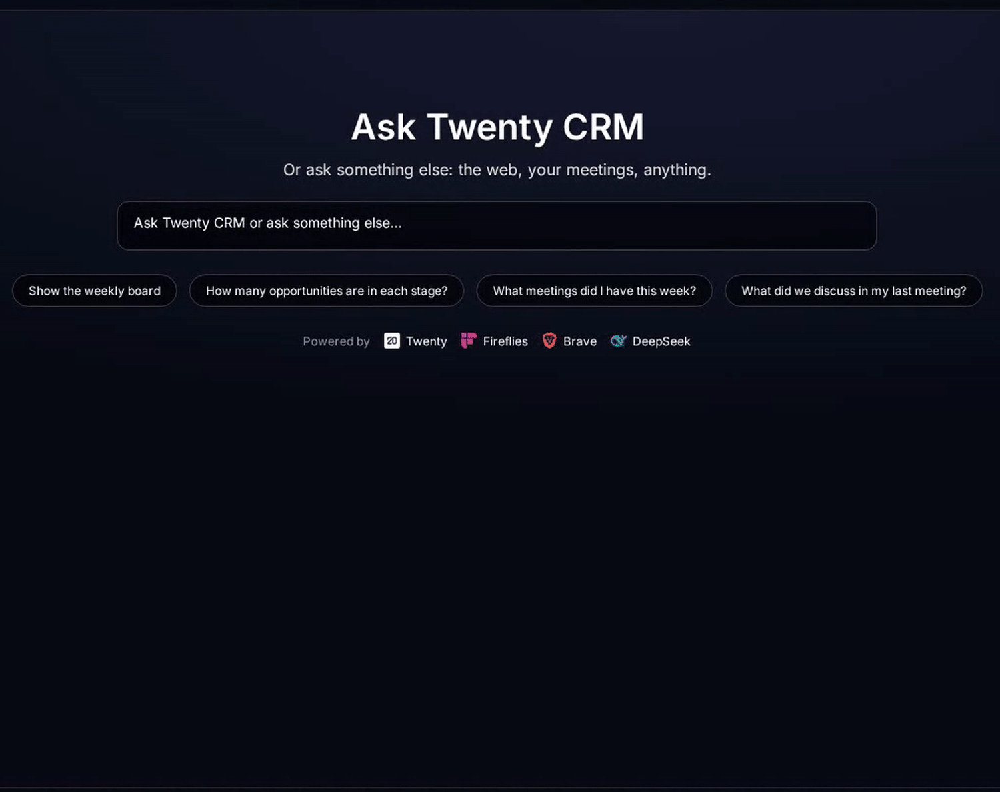
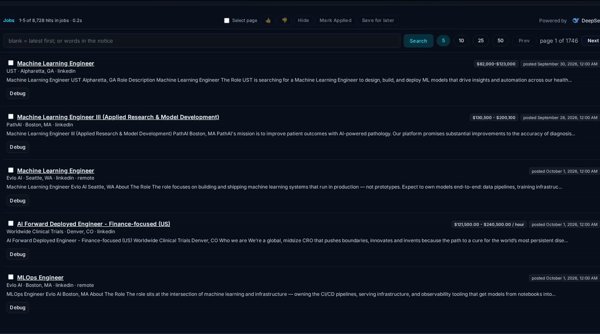
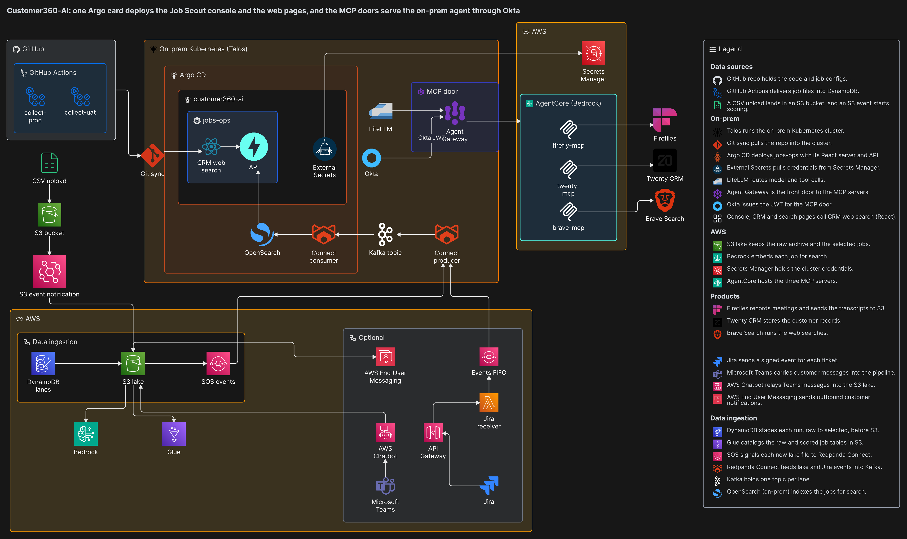

# Customer360-AI

One place for customers, deals, meetings and job leads, answered in plain language.

## See it work

**One question, three sources.** Ask a plain question before a customer meeting. The answer comes from the CRM, the meeting notes and the web at once, with the sources listed under it. The customer and the meeting are made up.

**Search the jobs.** Collected job posts become searchable by role, place or topic in seconds. Tick any number of results and act on all of them from the bar at the top.

## Executive summary

- One place for customers, prospects, opportunities, meetings and job leads, askable in plain language.
- Customers, people and deals live in [Twenty](https://twenty.com), an open source CRM the business owns and can run wherever it chooses.
- Every meeting is recorded by [Fireflies](https://fireflies.ai); transcripts and summaries are collected, untitled meetings are given a clear title, and what was said is indexed by meaning.
- One assistant, Customer360, answers from the CRM, the meetings and the web through [Brave Search](https://search.brave.com) at once, cites each source, and applies CRM changes only after a person approves.

## Architecture

Scheduled collection and a CSV upload feed the same lake.

## Capabilities

| Capability | What it does | Why it matters |
|---|---|---|
| **Dashboard assistant (Customer360)** | One assistant named Customer360 answers from the Twenty CRM, the Fireflies meeting transcripts and summaries already collected, and the web through Brave Search at once, with the sources listed under each answer; ask about any recorded call and it answers from that call's transcript and summary. It proposes CRM changes and applies them only after a person approves. | One question replaces three tools and a spreadsheet. |
| **Jobs** | Scheduled collection keeps job postings from job boards in one place. Each posting is graded for fit by an AI model on [Amazon Bedrock](https://aws.amazon.com/bedrock/), embedded so search understands meaning, and flagged when off target (wrong employer type, below the pay floor, not AI); nothing is deleted and every posting stays searchable. | Every matching role is in one list, the best matches rise to the top, and a filter can change later while a dropped lead is gone. |
| **Application Tracking** | A job or contract goes to Twenty in one step, with the company, the opportunity and the link back to the posting; a job marked applied then gets a status and moves through the board from first contact to outcome. | The CRM stays current without re-typing, and there is one current state per application, so nothing is chased twice. |
| **Government Opportunities** | [SAM.gov](https://sam.gov) notices arrive with response dates and saved attachments. Each is graded for fit on Amazon Bedrock, embedded so search understands meaning, and flagged when off target; nothing is deleted and every notice stays searchable. | Government work is tracked beside commercial work with the best matches first, so no response date is missed. |
| **[Slack](https://slack.com) and [Jira](https://www.atlassian.com/software/jira)** | Optional, and not switched on in this deployment. Slack: ask in a channel or thread and get a short AI answer back in the same thread. Jira: a new or changed ticket is queued so a separate job can prepare a pull request for review. Both verify the sender, process in order without duplicates, and alert on failure. | Extends the assistant into the tools the team already uses. |

## Stack

| Component | Tool | Link |
|---|---|---|
| CRM | Twenty | https://twenty.com |
| Meeting capture | Fireflies | https://fireflies.ai |
| Search | OpenSearch | https://opensearch.org |
| Fit scoring and embeddings | Amazon Bedrock | https://aws.amazon.com/bedrock/ |
| Web answers | Brave Search | https://search.brave.com |
| Government notices | SAM.gov | https://sam.gov |
| Chat connectors (optional) | Slack, Jira | https://slack.com, https://www.atlassian.com/software/jira |

## Quick start

1. Deploy the app and point it at your CRM.
2. Connect the meeting recorder and the sources you want collected.
3. Open the console and ask a question.

## Status

Active development. Live today: one-question answers across the CRM, meetings and the web, job search, and application tracking. Not switched on in this deployment: the optional chat connectors.

## License

PolyForm Noncommercial 1.0.0: free for noncommercial use; resale or any commercial use needs written permission first. See [LICENSE](LICENSE).
