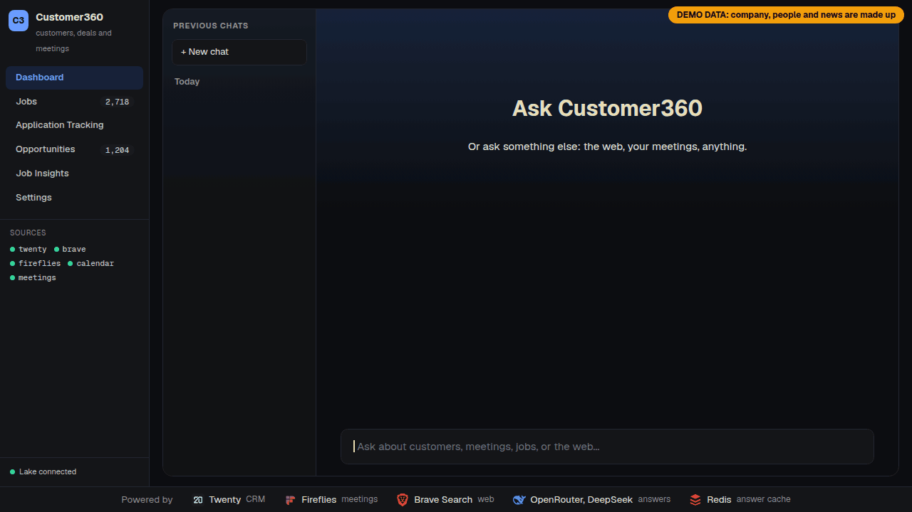
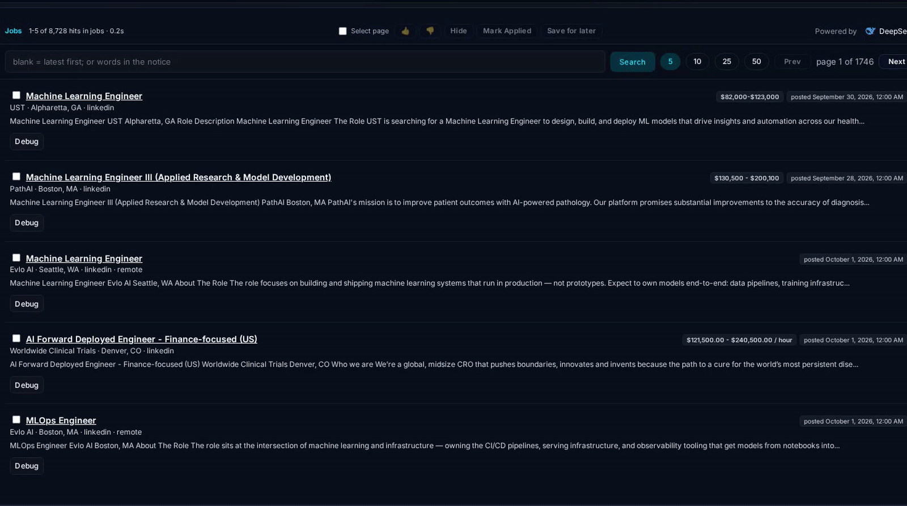
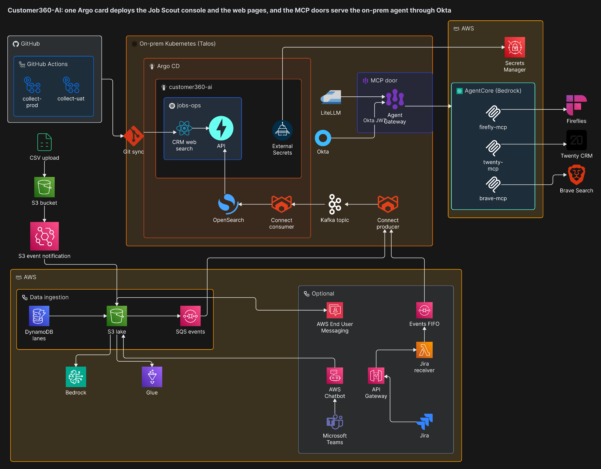

# Customer360-AI

## Executive summary

Customers, prospects, opportunities, meetings and job leads in one place, answered in plain language. Deals live in [Twenty](https://twenty.com), a CRM the business owns and hosts wherever it chooses. [Fireflies](https://fireflies.ai) records meetings, and they are indexed by meaning. One assistant, Customer360, answers from the CRM, the meetings and the web ([Brave Search](https://search.brave.com)), cites each source, and changes the CRM only after a person approves.

- **Dashboard assistant (Customer360).** Ask what a kickoff decided, what stage a deal is in, or a company's latest news, and get one cited answer from  [Twenty CRM](https://twenty.com),  [Fireflies](https://fireflies.ai) and  [Brave Search](https://search.brave.com).  [React](https://react.dev/) serves the pages,  [LiteLLM](https://litellm.ai/) routes model and tool calls,  [Agent Gateway](https://agentgateway.dev/) fronts the MCP servers,  [Okta](https://www.okta.com/) issues the JWT for the MCP gateway, and  [AgentCore](https://aws.amazon.com/bedrock/agentcore/) hosts the three MCP servers. Changes need a person's approval. One question replaces three tools and a spreadsheet.
- **Jobs and Application Tracking.** Jobs arrive as files from  [GitHub Actions](https://github.com/features/actions) or as  CSV uploads to  [S3](https://aws.amazon.com/s3/).  [DynamoDB](https://aws.amazon.com/dynamodb/) stages each run from raw to selected, S3 keeps the raw archive and the selected jobs,  [Glue](https://aws.amazon.com/glue/) catalogs the tables, and  [Bedrock](https://aws.amazon.com/bedrock/) embeds each job for search.  [SQS](https://aws.amazon.com/sqs/) hands each file to  [Redpanda Connect](https://www.redpanda.com/connect), which feeds  [Kafka](https://kafka.apache.org/) (one topic per lane) into  [OpenSearch](https://opensearch.org/). Each posting is graded for fit and flagged when off target (wrong employer type, below the pay floor, not AI); nothing is deleted and all stay searchable. Approved jobs move to  [Twenty CRM](https://twenty.com) and through the board from first contact to outcome, with no re-typing.
- **Slack and Jira (optional, off in this deployment).** Ask in a Slack channel and get a short answer in the thread. A new or changed  [Jira](https://www.atlassian.com/software/jira) ticket is queued for a separate job that prepares a pull request for review.  [AWS End User Messaging](https://aws.amazon.com/end-user-messaging/) sends outbound customer notifications. All three verify the sender and alert on failure.
- **Platform.** Code lives in  [GitHub](https://github.com/) and  [Git sync](https://github.com/kubernetes/git-sync) pulls it into a  [Talos](https://www.talos.dev/) cluster, which  [Argo CD](https://argo-cd.readthedocs.io/en/stable/) keeps converged to Git. Credentials come from  [Secrets Manager](https://aws.amazon.com/secretsmanager/) through  [External Secrets](https://external-secrets.io/). One commit deploys the product, and nothing secret lives in git.

## In action

**Three questions about a made-up company, then the Job Insights page.**

**Search the jobs.**

Both clips are recorded on demo data. The company, employers and every figure (Acme Demo Co (DEMO)) are made up; no real customer or system is in it.

## Architecture

Scheduled collection and a CSV upload feed the same lake.

- **Web UI.** The  [React](https://react.dev) pages and their API ship together to Kubernetes through  [Argo CD](https://argo-cd.readthedocs.io).
- **Credentials.** Every key comes from a password manager at run time; none is in the code or the images.

## License

PolyForm Noncommercial 1.0.0: free for noncommercial use; resale or any commercial use needs written permission first. See [LICENSE](LICENSE).
